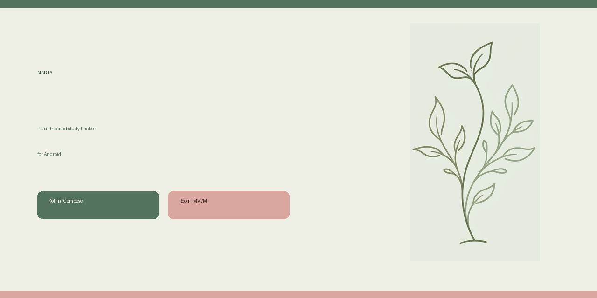

# 🌱 نبتة — Nabta

**A calm, Arabic-first study tracker for Android.** Organise your subjects, break them into chapters, and watch your progress grow — one leaf at a time.



## ✨ Features

- **Subjects & chapters** — create subjects (theory / practical) and split each one into study items you can tick off.
- **Progress at a glance** — per-subject progress bars, remaining counts, and an all-done state.
- **Search & filters** — filter by all / completed / remaining and search subjects or items instantly.
- **Gentle reminders** — schedule recurring study notifications with a configurable interval (AlarmManager), plus a test notification from settings.
- **Plant-themed design** — a soft botanical palette, Cairo font, hand-drawn leaf icons, and no emoji clutter.
- **Fully offline** — Room keeps everything on-device; no account required.

## 🛠️ Tech stack

| Layer | Tech |
|---|---|
| Language | Kotlin 2.2 |
| UI | Jetpack Compose + Material 3 |
| Persistence | Room (KSP) + Coroutines / Flow |
| Architecture | MVVM — Repository, ViewModel, StateFlow |
| Reminders | AlarmManager + NotificationCompat |
| AI | Firebase AI (Gemini) dependency wired for future study helpers |
| Build | Gradle 9, AGP 9, version catalog |

## 🚀 Build & run

```bash
git clone https://github.com/hoba101/reminder.git
cd reminder
./gradlew assembleDebug          # APK at app/build/outputs/apk/debug/
./gradlew installDebug           # install on a connected device/emulator
```

Requirements: JDK 17+, Android SDK 36. A release APK is published on the
[Releases page](https://github.com/hoba101/reminder/releases).

> The app is generated from the Google AI Studio Android template; `com.example`
> is still the package name and will be renamed before a Play Store release.

## 📁 Project structure

```
app/src/main/java/com/example/
├── MainActivity.kt
├── data/
│   ├── model/StudyEntities.kt      # Subject, StudyItem, SubjectWithItems
│   ├── dao/StudyDao.kt
│   ├── db/AppDatabase.kt
│   └── repository/StudyRepository.kt
├── notifications/                  # Reminder receiver + notification helper
└── ui/
    ├── StudyViewModel.kt
    ├── dashboard/DashboardScreen.kt
    ├── components/                 # Botanical icons and shared UI
    └── theme/                      # Colours, typography, theme
```

## 🎨 Design

The palette is built around sage green, cream and soft rose. The app is RTL-first,
uses the Cairo typeface for Arabic, and keeps motion subtle. The leaf artwork ships
as vector-friendly drawables so it scales cleanly on every density.

## 🗺️ Roadmap

- [ ] Rename package to a personal application ID and sign a release build
- [ ] Add weekly statistics and streaks
- [ ] Optional cloud sync (Firestore) with offline-first conflict handling
- [ ] Home-screen widget with today's remaining items

## 📄 License

[MIT](LICENSE) © 2026 Miro (Ehab)
